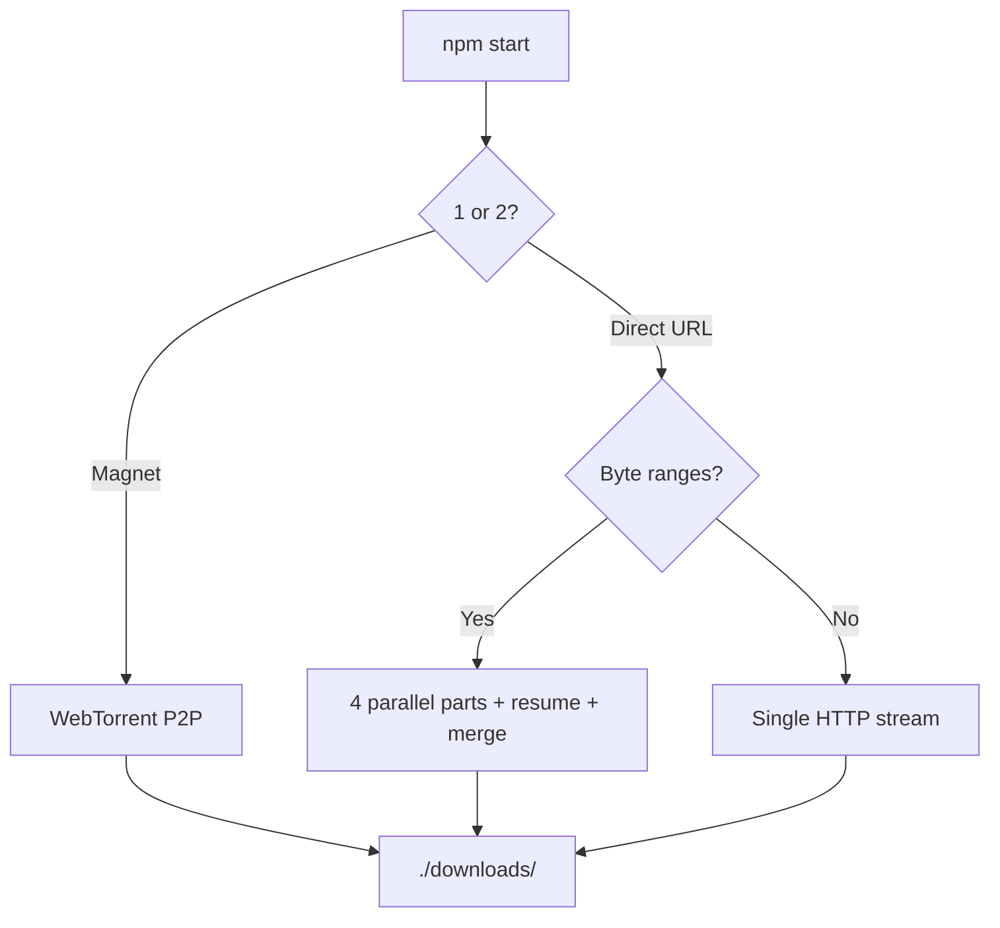

# Torrent & HTTP Download CLI

**Two download modes in one Node.js terminal app:**

1. **Magnet / torrent** — WebTorrent P2P with peers, speed, and ETA  
2. **Direct HTTP(S)** — **4-part parallel multipart download** with byte-range resume  

Shared **progress bar**, validation, and `./downloads/` output. Not just a torrent client.

> **Keywords:** torrent downloader, magnet link, WebTorrent, BitTorrent, P2P, HTTP download, direct download, multipart download, parallel download, byte-range, resume download, Node.js CLI, terminal downloader, progress bar.

Formerly **nodeWT** / **webtorrent-cli-client**.

[](https://nodejs.org/)
[](LICENSE)
[](https://webtorrent.io/)

## Table of contents

- [Why this exists](#why-this-exists)
- [Two download modes](#two-download-modes)
- [Features](#features)
- [Quick start](#quick-start)
- [Usage](#usage)
  - [Mode 1 — Magnet URL (torrent)](#mode-1--magnet-url-torrent)
  - [Mode 2 — Direct URL (multipart HTTP)](#mode-2--direct-url-multipart-http)
- [Progress bar](#progress-bar)
- [How it works](#how-it-works)
- [Configuration](#configuration)
- [Project layout](#project-layout)
- [Troubleshooting](#troubleshooting)
- [Responsible use](#responsible-use)
- [Contributing](#contributing)
- [License](#license)

---

## Why this exists

You often need a **terminal downloader** without installing a full GUI — whether the source is a **magnet link** or a **plain HTTPS file URL**.

This CLI handles **both**:

- **Torrents** via [WebTorrent](https://webtorrent.io/) — magnet links, peer discovery, live peer count  
- **Direct files** via native `fetch` — **4 concurrent HTTP range parts**, automatic merge, and **resume** after interruption  

One progress bar, one `./downloads/` folder, one `npm start` menu.

---

## Two download modes

| | **1. Magnet / torrent** | **2. Direct HTTP(S)** |
|---|---------------------------|------------------------|
| **When to use** | `.torrent` / magnet P2P sources | CDN, mirror, or any direct file link |
| **Input** | `magnet:?xt=urn:btih:…` | `https://example.com/file.iso` |
| **Engine** | WebTorrent (BitTorrent P2P) | `fetch` + `Range: bytes=` |
| **Parallelism** | WebTorrent piece picker | **4 parallel byte-range parts** |
| **Resume** | WebTorrent built-in | Part files in `.downloads/.nodewt/` |
| **Peers** | Shown in progress bar | N/A (`Peers: 0`) |
| **Fallback** | — | Single-stream if server has no ranges |

---

## Features

- **Dual-mode menu** — pick torrent or direct URL at startup  
- **Multipart HTTP** — 4-part parallel download when `Accept-Ranges: bytes` is supported  
- **Resume** — interrupted direct downloads continue from saved parts  
- **WebTorrent** — magnet validation, DHT, peer stats  
- **cli-progress** bar — size, speed, ETA, percentage  
- **Node.js 22+** — native `fetch` for HTTP; no extra HTTP client  
- **Cross-platform** — macOS, Linux, Windows  

---

## Quick start

### Prerequisites

- **Node.js 22+** ([nodejs.org](https://nodejs.org/) or `nvm install 22`)
- **npm** or **yarn**

### Install

```bash
git clone https://github.com/danted4/torrent-http-download-cli.git
cd torrent-http-download-cli
npm install
```

### Run

```bash
npm start
```

```
Choose download type:
1. Magnet URL
2. Direct URL (multi-part)
```

---

## Usage

### Mode 1 — Magnet URL (torrent)

```
1

Please paste your magnetURI:

magnet:?xt=urn:btih:08ada5a7a6183aae1e09d831df6748d566095a10
```

WebTorrent connects to peers, downloads to `./downloads/`, and exits at 100%.

### Mode 2 — Direct URL (multipart HTTP)

```
2

Please paste the direct download URL:

https://example.com/large-file.iso
```

**Server supports byte ranges** (`Content-Length` + `Accept-Ranges: bytes`):

1. Splits the file into **4 parts**  
2. Downloads parts **in parallel**  
3. **Resumes** from `.downloads/.nodewt/` if interrupted  
4. **Merges** into the final file in `./downloads/`  

**No range support:** automatically falls back to a single streamed download.

Filename from `Content-Disposition` header or URL path.

---

## Progress bar

```
[████████████████░░░░] 75% | Peers: 12 | D: 750.45 MB @ 2.5 MB/s | T: 1.0 GB | ETA: 2 minutes
```

| Field | Magnet mode | Direct HTTP mode |
|-------|-------------|------------------|
| Bar / `%` | Torrent progress | Bytes received / total |
| `Peers` | Live peer count | `0` |
| `D` / `@` / `T` / `ETA` | Downloaded, speed, total, time left | Same |

---

## How it works



- **Torrent:** `server.js` → `startDownload()` → WebTorrent  
- **Direct:** `server.js` → `startURLDownload()` → `fetch` with `Range` headers → merge  

---

## Configuration

### Download folder

Default: `./downloads`. In `src/client/index.js`:

```javascript
const DOWNLOAD_DIRECTORY = './downloads';
```

For magnet mode, also update `path` in `client.add(…)`.

### Parallel part count

Direct multipart uses `PART_COUNT = 4` in `src/client/index.js`.

### Progress bar format

Edit `getDisplayFormat()` in `src/utils/formatters/index.js`.

---

## Project layout

```
torrent-http-download-cli/
├── server.js              # Mode menu: magnet vs direct URL
├── src/client/index.js    # startDownload() + startURLDownload()
├── src/utils/             # formatters, loaders, logger, validators
├── downloads/             # Output (gitignored)
└── package.json
```

---

## Troubleshooting

| Problem | Fix |
|---------|-----|
| `Invalid magnet URL` | Must start with `magnet:?xt=urn:` and include a valid info hash |
| No peers / slow torrent | Wait for DHT; try a seeded magnet; check firewall |
| `Invalid HTTP(S) URL` | Full `http://` or `https://` URL required |
| Multipart not used | Server may not send `Accept-Ranges: bytes` — single stream is used instead |
| Resume not working (HTTP) | Keep the same URL; state is in `.downloads/.nodewt/` |
| Node version error | Need Node 22+: `node --version` |

---

## Responsible use

Download only **content you have the legal right to access**. Generic tool — not affiliated with WebTorrent beyond using their OSS library.

---

## Contributing

Issues and PRs welcome. No copyrighted files or illegal magnet links in issues.

---

## License

[MIT](LICENSE)

---

**Made by [danted4](https://github.com/danted4)**
