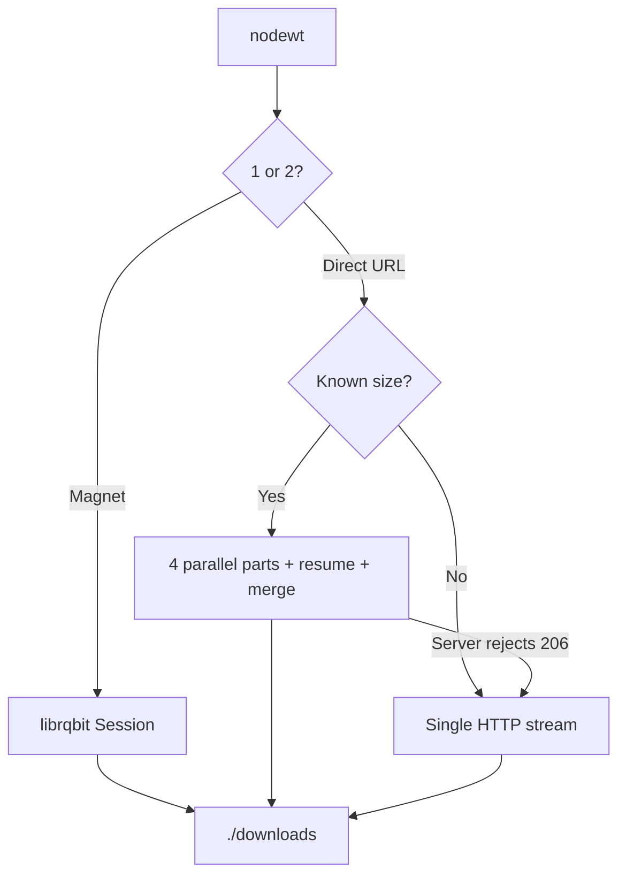

# Torrent & HTTP Download CLI

Terminal downloader with two modes. No GUI, no HTML, no CSS.

1. **Magnet / torrent** — BitTorrent via [librqbit](https://github.com/ikatson/rqbit) (peers, speed, ETA)
2. **Direct HTTP(S)** — **4-part parallel multipart download** with byte-range resume

Shared progress bar and `./downloads/` output. Cross-platform: Linux, macOS, Windows.

## Why this exists

You often need a **terminal downloader** without a GUI — whether the source is a **magnet link** or a **plain HTTPS file URL**.

## Two download modes

| | **1. Magnet / torrent** | **2. Direct HTTP(S)** |
|---|---------------------------|------------------------|
| **When to use** | `.torrent` / magnet P2P sources | CDN, mirror, or any direct file link |
| **Input** | `magnet:?xt=urn:btih:…` | `https://example.com/file.iso` |
| **Engine** | librqbit (BitTorrent P2P) | `reqwest` + `Range: bytes=` |
| **Parallelism** | Piece picker | **4 parallel byte-range parts** |
| **Resume** | librqbit built-in | Part files in `downloads/.nodewt/` |
| **Peers** | Shown in progress bar | `Peers: 0` |
| **Fallback** | — | Single-stream if the server has no ranges |

## Features

- Interactive menu or CLI subcommands
- Multipart HTTP when the server honors `Range`
- Resume interrupted direct downloads
- Magnet validation (32-char base32 and 40-char hex info hashes)
- Progress: size, speed, ETA, percentage, peers
- rustls TLS (no OpenSSL required)

## Prerequisites

- [Rust](https://rustup.rs/) 1.85+ (stable) with Cargo
- Network access; torrents need UDP allowed for DHT where possible

## Build

```bash
git clone https://github.com/danted4/torrent-http-download-cli.git
cd torrent-http-download-cli
cargo build --release
```

The binary is `target/release/nodewt` (`.exe` on Windows).

```bash
# Linux / macOS
./target/release/nodewt

# Windows
.\target\release\nodewt.exe
```

## Usage

### Interactive (same menu as the old Node app)

```
Choose download type:
1. Magnet URL
2. Direct URL (multi-part)
```

### Commands

```bash
nodewt magnet "magnet:?xt=urn:btih:…"
nodewt http "https://example.com/large-file.iso"
```

**Magnet:** connects to peers, writes to `./downloads/`, exits at 100%.

**HTTP with byte ranges:** splits into 4 parts, downloads in parallel, resumes from `downloads/.nodewt/` if interrupted, then merges into `./downloads/`.

**No range support:** single streamed download. This fallback **does not resume**; it truncates the destination and starts over.

Filename comes from `Content-Disposition` or the URL path (a single path component only; `.` / `..` become `download.bin`).

Torrent mode enables DHT in memory only (no DHT state written outside `./downloads`) and stops the session when the download finishes.

## Progress bar

```
[████████████████░░░░] 75% | Peers: 12 | D: 750.45 MB @ 2.5 MB/s | T: 1.0 GB | ETA: 2 minutes
```

## How it works



## Configuration

- Download folder: `./downloads` (`DOWNLOAD_DIRECTORY` in `src/http.rs`)
- Parallel parts: `PART_COUNT = 4` in `src/http.rs`
- Progress format: `BAR_TEMPLATE` in `src/progress.rs`

## Development

```bash
cargo test
cargo fmt --check
cargo clippy --all-targets -- -D warnings
```

GitHub Actions runs fmt, clippy (`-D warnings`), and tests on **Linux, macOS, and Windows** for every push and pull request to `main`.

## Cross-platform builds

TLS uses rustls. Typical release targets:

```bash
cargo build --release --target aarch64-apple-darwin
cargo build --release --target x86_64-apple-darwin
cargo build --release --target x86_64-unknown-linux-gnu
cargo build --release --target x86_64-pc-windows-msvc
```

Install the target first: `rustup target add <triple>`. Windows GNU/MSVC toolchains must be available on the build machine.

## Troubleshooting

| Problem | Fix |
|---------|-----|
| `Invalid magnet URL` | Must start with `magnet:?xt=urn:` and include a 32+ character info hash |
| No peers / slow torrent | Wait for DHT; try a seeded magnet; check firewall/UDP |
| `Invalid HTTP(S) URL` | Full `http://` or `https://` URL required |
| Multipart not used | Server did not return HTTP 206 — single stream is used instead |
| Resume not working (HTTP) | Keep the same URL; state is in `downloads/.nodewt/` |
| Rust version error | Need a recent stable toolchain (`rustup update`) |

## Responsible use

Download only **content you have the legal right to access**. Generic tool — not affiliated with rqbit beyond using their OSS library.

## License

[MIT](LICENSE)
