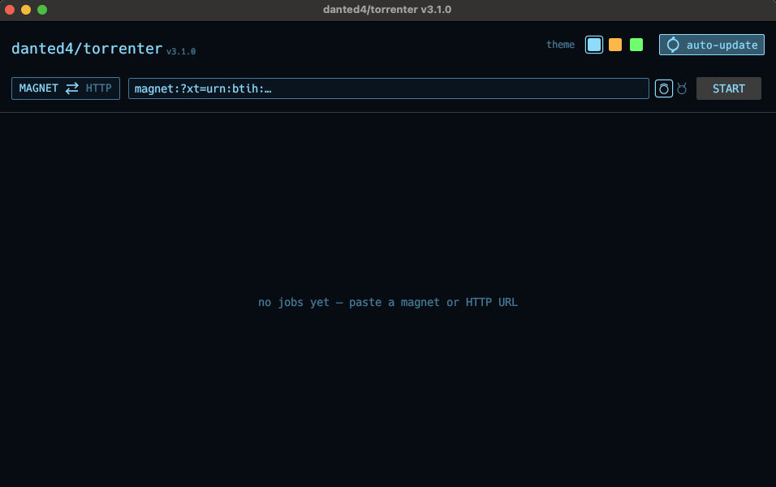
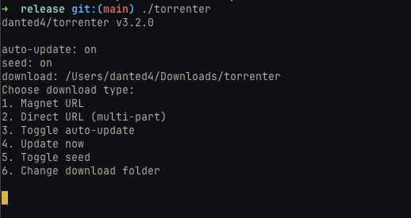
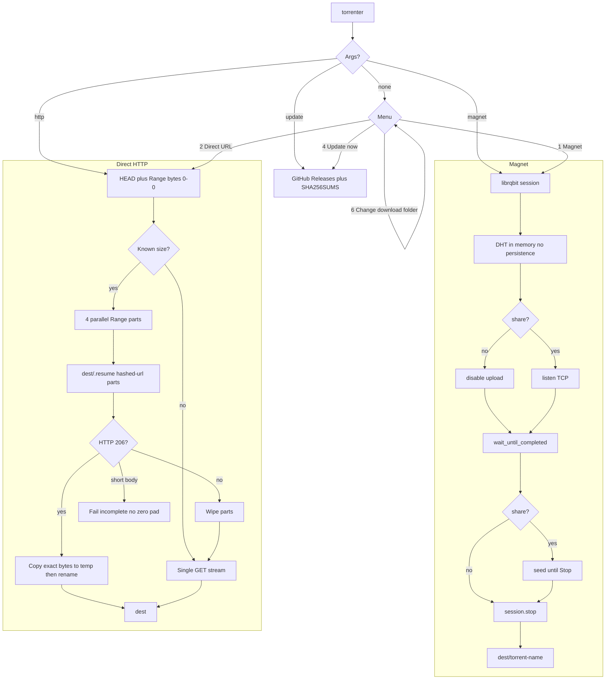

# torrenter

**torrenter gui**



**torrenter cli**



Downloader with two engines and two fronts. Each [GitHub Release](https://github.com/danted4/torrenter/releases) ships a **CLI** binary and a **native GUI** binary (egui, no HTML/CSS).

1. **Magnet / torrent** — BitTorrent via [librqbit](https://github.com/ikatson/rqbit)
2. **Direct HTTP(S)** — 4-part parallel download with byte-range resume

Output goes to `<OS Downloads>/torrenter` until you pick another folder. Runs on Linux, macOS, and Windows. Both fronts show `danted4/torrenter vX.Y.Z`. Auto-update is **off** by default.

## Two download modes

| | **Magnet / torrent** | **Direct HTTP(S)** |
|---|----------------------|---------------------|
| **Use when** | magnet P2P | CDN, mirror, or any direct file URL |
| **Input** | `magnet:?xt=urn:btih:…` | `https://example.com/file.iso` |
| **Engine** | librqbit | `reqwest` + `Range: bytes=` |
| **Parallelism** | piece picker | 4 byte-range parts |
| **Resume** | librqbit on disk under `<dest>/<torrent-name>/` | `<dest>/.resume/` part files |
| **Peers** | live count in the bar | `Peers: 0` |
| **Upload** | **Share** (default): upload while downloading and keep seeding until Stop. **Leech**: never upload; stop at 100% | — |
| **Fallback** | — | single stream if the server ignores ranges |

Magnet links need a 32-character base32 or 40-character hex info hash. `.torrent` files are not accepted. HTTP names come from `Content-Disposition` or the URL path (one path component only; `.` / `..` become `download.bin`).

Single-stream HTTP **does not resume**. It truncates the destination and starts over.

## Install

Pre-built binaries and `SHA256SUMS` are on [GitHub Releases](https://github.com/danted4/torrenter/releases):

| OS | CLI | GUI |
|----|-----|-----|
| Linux x86_64 | `torrenter-x86_64-unknown-linux-gnu` | `torrenter-gui-x86_64-unknown-linux-gnu` |
| macOS Apple Silicon | `torrenter-aarch64-apple-darwin` | `torrenter-gui-aarch64-apple-darwin` and `torrenter-gui-aarch64-apple-darwin.app.zip` |
| macOS Intel | `torrenter-x86_64-apple-darwin` | `torrenter-gui-x86_64-apple-darwin` and `torrenter-gui-x86_64-apple-darwin.app.zip` |
| Windows x86_64 | `torrenter-x86_64-pc-windows-msvc.exe` | `torrenter-gui-x86_64-pc-windows-msvc.exe` |

Releases are **unsigned**. The GUI updater still downloads the naked `torrenter-gui-*` Mach-O / `.exe` (CLI uses `torrenter-*`). The macOS `.app.zip` is extra packaging for Launchpad; it is not the updater asset.

On Unix: `chmod +x` the CLI (and the naked GUI if you use it). Put the CLI on your `PATH` if you want. No Rust/Cargo needed at runtime.

**macOS GUI (Launchpad).** Download `torrenter-gui-<arch>-apple-darwin.app.zip`, double-click to unzip **`torrenter.app`**, drag it to **Applications**. GitHub sets `com.apple.quarantine`:

```bash
xattr -dr com.apple.quarantine /Applications/torrenter.app
open /Applications/torrenter.app
```

If macOS still blocks it: right-click **torrenter** → **Open** → **Open**, or **System Settings → Privacy & Security** → **Open Anyway**. Spotlight and Launchpad list it after it sits in Applications.

**macOS CLI / naked GUI.** Same quarantine on the Mach-O:

```bash
chmod +x torrenter-gui-aarch64-apple-darwin   # or the Intel / CLI name
xattr -d com.apple.quarantine torrenter-gui-aarch64-apple-darwin
./torrenter-gui-aarch64-apple-darwin
```

**Windows (SmartScreen).** Double-click the `.exe`. If **Windows protected your PC** appears: **More info** → **Run anyway**. Microsoft Defender may scan the first run. Share-mode magnets can prompt Windows Firewall for inbound TCP (allow if you want peers to connect). Pin-to-taskbar uses the icon baked into the `.exe` (v3.2.1+).

Linux GUI needs GTK 3 and xcb at run time (`libgtk-3-0 libxkbcommon0 libxcb-render0 libxcb-shape0 libxcb-xfixes0` on Debian/Ubuntu). The CLI does not.

A `vX.Y.Z` tag whose commit is on `main` builds those assets.

From source (Rust 1.85+):

```bash
git clone https://github.com/danted4/torrenter.git
cd torrenter
cargo build --release
cargo build --release --features gui --bin torrenter-gui
./target/release/torrenter              # Windows: .\target\release\torrenter.exe
./target/release/torrenter-gui          # Windows: .\target\release\torrenter-gui.exe
```

## Usage

### CLI

Interactive (no arguments):

```
danted4/torrenter v3.2.3
auto-update: off
seed: on
download: /Users/you/Downloads/torrenter
Choose download type:
1. Magnet URL
2. Direct URL (multi-part)
3. Toggle auto-update
4. Update now
5. Toggle seed
6. Change download folder
```

Commands:

```bash
torrenter magnet "magnet:?xt=urn:btih:…"
torrenter http "https://example.com/large-file.iso"
torrenter magnet "magnet:?xt=urn:btih:…" --dir /tmp/out   # one-shot, not saved
torrenter --auto-update          # persist: check GitHub Releases on startup (TTY only)
torrenter --no-auto-update
torrenter update                 # install the latest matching CLI asset now
```

While a download runs, type `1` then Enter to pause/resume, or `2` then Enter to stop. HTTP pause aborts the live Range body and continues from `<dest>/.resume/` on resume. Pause on a single-stream (no Range) download starts that GET over. Stop is honored during HEAD, range probe, part copy, and merge.

Torrent mode uses DHT in memory only. **Share** (default, `seed: on`) uploads while downloading, opens an incoming TCP listen on a random high port, and stays connected after 100% until you press `2` or quit — `torrenter magnet` will not return when the file is complete. **Leech** (`seed: off`) never uploads and calls `session.stop()` at 100%. The OS may prompt for a firewall exception the first time a share-mode magnet runs. Each magnet writes into `<dest>/<torrent-name>/` (whitespace becomes `_`) so two torrents with the same filenames do not clobber each other. If the magnet has no name, or that folder belongs to a different info-hash, the folder is the hash (or `name_hash`). Overwrite is allowed only inside that folder so a retry can resume. Closing the CLI or GUI drops every seed.

Startup auto-update is skipped when stdin is not a TTY (scripts, pipes). `torrenter update` always runs when you ask.

### GUI

Same engines, phosphor / amber / ice themes (last pick is saved in config), magnet/HTTP swap on the URL row, share/leech glyphs (halo vs horns) between the URL field and START (faded and inactive in HTTP mode), dest path under the URL row, pause / stop / clear per row. **Stop** immediately shows **clear** (and **restart**), including queued or incomplete magnets — not only after 100%. Click a job title to open that job’s folder. Idle magnet and stopped HTTP rows use **restart**, which opens a confirm popup (original mode and dest; START begins the job). A **search** field above the list filters jobs by title, URL, folder, MAGNET/HTTP, or info-hash (`Esc` clears). Auto-update checkbox. Update-check notes and folder errors land in a bottom-right toast (info ~1.5s, errors 5s, click to dismiss; in-progress “checking/installing” and dest/update fatals stay until replaced or clicked). The window must stay open to keep seeding.

```bash
./torrenter-gui-aarch64-apple-darwin    # or the asset for your OS
```

At most four downloads run at once; further rows stay queued. The same magnet (or HTTP URL) cannot start twice while it is already active. A second copy of the same info hash also waits on an in-process folder lock.

The GUI binary only replaces itself with `torrenter-gui-*` assets; the CLI binary only replaces itself with `torrenter-*` assets. The binary directory must be writable. Auto and manual install are the same: the new Mach-O overwrites **this** executable (Windows first renames the running file to `*.old`). Startup deletes leftover `*.old`, `.*.update`, and `.*.sha256sums` next to it. If you launched from `torrenter.app`, that bundle stays; only `Contents/MacOS/torrenter-gui` is swapped, then `Info.plist` is restamped and the app is ad-hoc signed again. Other copies (Downloads, an old zip) are not searched or deleted.

## Updates

Opt-in. The updater downloads only `https://github.com/danted4/torrenter/releases/download/<tag>/<name>` (tag in the path must match the release), checks `SHA256SUMS`, caps size, and times out. GitHub then 302s to `objects.githubusercontent.com`; that redirect is followed because the first hop is pinned.

`SHA256SUMS` is **same-publisher integrity**, not a signature. A stolen GitHub token can still ship a binary and a matching sums file.

## Progress bar

```
[████████████████░░░░] 75% | Peers: 12 | D: 750.45 MB @ 2.5 MB/s | T: 1.0 GB | ETA: 2 minutes
[████████████████████] 100% | Peers: 8 | U: 120.00 MB @ 1.1 MB/s | T: 1.0 GB
```

## How it works



HTTP resume keeps `{sha256(url)[0..16]}.part-N` plus a small JSON manifest under `<dest>/.resume/`. Oversized parts are truncated before append; a short 206 is an error, not a zero-filled hole. Merge writes `.{filename}.merge.tmp` then replaces the final file.

## Configuration

- Download folder: `<OS Downloads>/torrenter` until `download_dir` is set (`src/paths.rs`)
- Parallel HTTP parts: `PART_COUNT = 4` in `src/http.rs`
- GUI concurrent jobs: 4
- Progress format: `BAR_TEMPLATE` in `src/progress.rs`
- HTTP and updater timeouts: 20s connect, 60s between reads
- Auto-update, magnet seed, GUI `theme`, and optional `download_dir`: `~/.config/torrenter/config.json` (macOS: `~/Library/Application Support/torrenter/config.json`, Windows: `%APPDATA%\torrenter\config.json`). `seed` defaults to on. `theme` is `phosphor`, `amber`, or `ice` (default phosphor). Missing `download_dir` keeps following the live OS Downloads path.

## Development

```bash
cargo test --all-features
cargo fmt --check
cargo clippy --all-targets --all-features -- -D warnings
```

CI on every push and pull request to `main`: fmt, clippy (`-D warnings`), tests on Linux, macOS, and Windows (`--all-features` so the GUI compiles).

Release: `git tag vX.Y.Z && git push origin vX.Y.Z` (commit must already be on `main`). That publishes CLI + GUI binaries, macOS `torrenter-gui-*.app.zip`, and `SHA256SUMS`. Doc-only changes on `main` do not need a tag.

## Troubleshooting

| Problem | Fix |
|---------|-----|
| `Invalid magnet URL` | Must start with `magnet:?xt=urn:` and a 32-char base32 or 40-char hex hash |
| No peers / slow torrent | Wait for DHT; try a seeded magnet; check firewall/UDP |
| Share magnet, no upload | Keep the app open; allow the firewall prompt; leech mode never uploads and does not listen |
| `Too many open files` | torrenter raises the process limit when it can; otherwise `ulimit -n 10240` and retry |
| `Invalid HTTP(S) URL` | Full `http://` or `https://` URL required |
| Multipart not used | Server did not return HTTP 206 — single stream is used instead |
| Resume not working (HTTP) | Same URL and same dest folder; state is in `<dest>/.resume/` |
| Incomplete part | Server closed a Range early; retry the same URL |
| Linux GUI missing GTK/xcb | Install GTK 3 and xcb (see Install) |
| macOS “cannot be opened because it is from an unidentified developer” | `xattr -dr com.apple.quarantine` on `torrenter.app` or the Mach-O, then right-click **Open** or **Privacy & Security → Open Anyway** (see Install) |
| Windows SmartScreen / “Windows protected your PC” | **More info → Run anyway**. Builds are unsigned; this is expected |
| GUI says already downloading | Same magnet info-hash or HTTP URL is already active |
| Auto-update did nothing in a script | Startup check is TTY-only; use `torrenter update` |
| Update hash / URL refused | Asset must be this repo’s release for that tag, with a matching `SHA256SUMS` line |
| Rust version error | Recent stable toolchain if building from source (`rustup update`) |

## Responsible use

Download only **content you have the legal right to access**. Generic tool — not affiliated with rqbit beyond using their OSS library.

## License

[MIT](LICENSE)
