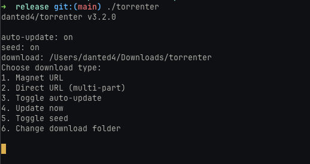
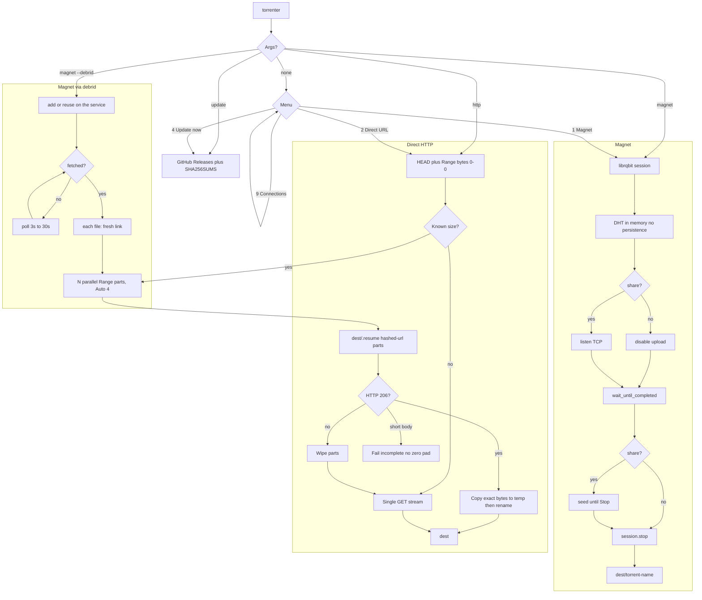

# torrenter &nbsp;  &nbsp; <a href="#windows"></a> <a href="#macos"></a> <a href="#linux"></a> <a href="#android"></a> <a href="#ios"></a> <a href="#mcp"></a> &nbsp;  &nbsp;

**torrenter gui**


<table>
   <tr>
   <th>
      android apk
   </th>
   <th>
      ios app
   </th>
   <th>
      torrenter cli
   </th>
   </tr>
   <tr>
   <td>
      
   </td>
   <td>
      
   </td>
   <td>
      
   </td>
   </tr>
</table>

No arguments opens the interactive menu (magnet, HTTP, auto-update, seed, download folder, debrid route, debrid accounts, connections). Subcommands:

```bash
torrenter magnet "magnet:?xt=urn:btih:…"
torrenter http "https://example.com/large-file.iso"
torrenter magnet "magnet:?xt=urn:btih:…" --dir /tmp/out   # one-shot, not saved
torrenter magnet "magnet:?xt=urn:btih:…" --debrid torbox  # through your debrid service
torrenter debrid add torbox      # save a key (typed hidden or piped); also test / remove / list
torrenter --auto-update          # persist: check GitHub Releases on startup (TTY only)
torrenter --no-auto-update
torrenter update                 # install the latest matching CLI asset now
torrenter mcp                    # stdio MCP (any host that can spawn a command)
```

While a download runs, type `1` then Enter to pause/resume, or `2` then Enter to stop.

Downloader with two engines, two desktop fronts, an **Android sideload APK**, an **iOS sideload app** you build on a Mac, and **stdio MCP**. Each [GitHub Release](https://github.com/danted4/torrenter/releases) ships a **CLI** binary, a **native GUI** binary (egui), and `torrenter-android.apk`. There is no iOS IPA on Releases, no App Store listing, and no in-app updater.

1. **Magnet / torrent** — BitTorrent via [librqbit](https://github.com/ikatson/rqbit), or optionally through **your own debrid service** (see [Debrid](#debrid-optional))
2. **Direct HTTP(S)** — multi-part parallel download (Auto = 4 connections) with byte-range resume

Output goes to `<OS Downloads>/torrenter` until you pick another folder. Both fronts show `danted4/torrenter vX.Y.Z`. Auto-update is **off** by default.

Pick your OS below. Magnet vs HTTP is in [Two download modes](#two-download-modes).

## Linux

1. Open the [latest GitHub Release](https://github.com/danted4/torrenter/releases/latest).
2. Download the CLI and/or GUI asset:
   - CLI: `torrenter-x86_64-unknown-linux-gnu`
   - GUI: `torrenter-gui-x86_64-unknown-linux-gnu`
3. Make it executable and put it on your `PATH` if you want:

   ```bash
   chmod +x torrenter-x86_64-unknown-linux-gnu torrenter-gui-x86_64-unknown-linux-gnu
   ```

4. **GUI only:** install GTK 3 and xcb at run time. On Debian/Ubuntu:

   ```bash
   sudo apt install libgtk-3-0 libxkbcommon0 libxcb-render0 libxcb-shape0 libxcb-xfixes0
   ```

   The CLI does not need these.

5. Run:

   ```bash
   ./torrenter-x86_64-unknown-linux-gnu
   ./torrenter-gui-x86_64-unknown-linux-gnu
   ```

Linux does **not** show SmartScreen or Gatekeeper. Outbound network is allowed by default on most desktops, so there is usually **no popup**. If a firewall GUI (ufw, firewalld, a VPN client) asks, click **Allow**. Share-mode magnets listen on a random high TCP port; a deny-incoming firewall can block seeding even when downloads still work.

No Rust/Cargo is needed at runtime. Building from source is in the [Development](#development) section.

## Windows

1. Open the [latest GitHub Release](https://github.com/danted4/torrenter/releases/latest).
2. Download the CLI and/or GUI asset:
   - CLI: `torrenter-x86_64-pc-windows-msvc.exe`
   - GUI: `torrenter-gui-x86_64-pc-windows-msvc.exe`
3. Double-click the `.exe` (or run it from PowerShell / Command Prompt).

> [!IMPORTANT]
> 🚨 Windows SmartScreen will often show **Windows protected your PC** because the binary is not a Microsoft-signed installer. If you skip the second click below, the app never starts. The `.exe` did not fail — SmartScreen blocked it.
>
> | ⚠️ | Do this or the app **never starts** |
> |---:|:---|
> | 1️⃣ | Click **More options** |
> | 2️⃣ | Click **Run anyway** |

Releases are **unsigned**. If Explorer still blocks the file, right-click it → **Properties** → check **Unblock** → **OK**, then run it again and use **More options** → **Run anyway** if SmartScreen appears. Microsoft Defender may scan the first run. Pin-to-taskbar uses the icon baked into the `.exe` (v3.2.1+).

> [!NOTE]
> Windows Defender Firewall often asks for network access on **first launch**, the **first share-mode magnet**, and again **after an update** (the new `.exe` looks like a different app).
>
> | ⚠️ | Do this or peers / share mode stay blocked |
> |---:|:---|
> | 1️⃣ | When Windows asks **Allow torrenter to communicate on these networks?** (or similar) |
> | 2️⃣ | Click **Allow** (Private networks is enough for most home PCs) |

Do not click **Cancel** or **Don’t allow** if you want magnet share mode or incoming peers.

## macOS

1. Open the [latest GitHub Release](https://github.com/danted4/torrenter/releases/latest).
2. Download the asset for your Mac (Apple Silicon `aarch64`, Intel `x86_64`):
   - CLI: `torrenter-<arch>-apple-darwin`
   - GUI for Launchpad: `torrenter-gui-<arch>-apple-darwin.app.zip`
   - GUI as a naked Mach-O (optional): `torrenter-gui-<arch>-apple-darwin`

   Releases are **unsigned**. The GUI updater still downloads the naked `torrenter-gui-*` Mach-O (CLI uses `torrenter-*`). The `.app.zip` is extra packaging for Launchpad; it is not the updater asset.

3. **GUI (Launchpad):** download the `.app.zip`, double-click to unzip **`torrenter.app`**, drag it to **Applications**. GitHub sets `com.apple.quarantine`:

   ```bash
   xattr -dr com.apple.quarantine /Applications/torrenter.app
   open /Applications/torrenter.app
   ```

   If macOS still blocks it (“Apple cannot check it for malicious software”): right-click **torrenter** → **Open** → **Open**, or **System Settings → Privacy & Security** → **Open Anyway**. Spotlight and Launchpad list it after it sits in Applications.

4. **CLI / naked GUI:**

   ```bash
   chmod +x torrenter-aarch64-apple-darwin torrenter-gui-aarch64-apple-darwin
   xattr -d com.apple.quarantine torrenter-aarch64-apple-darwin
   xattr -d com.apple.quarantine torrenter-gui-aarch64-apple-darwin
   ./torrenter-aarch64-apple-darwin
   ./torrenter-gui-aarch64-apple-darwin
   ```

> [!NOTE]
> macOS often shows a **network access** popup on **first open** and again **after an update** (a replaced binary is a new app to the OS). Wording varies: *would like to find and connect to devices on the local network*, or *accept incoming network connections*.
>
> | ⚠️ | Do this or magnet / share traffic is blocked |
> |---:|:---|
> | 1️⃣ | When the network popup appears |
> | 2️⃣ | Click **Allow** |

If you clicked Don’t Allow, open **System Settings → Network → Firewall** (or **Privacy & Security → Local Network**) and enable torrenter, then relaunch. Gatekeeper can also return after an update — clear quarantine again if macOS refuses to open the new file.

No Rust/Cargo is needed at runtime. Building from source is in the [Development](#development) section.

## Android

Sideload only — not on Google Play. minSdk **30**, ABIs `arm64-v8a` + `x86_64`. Same engines and chrome as the desktop GUI: magnet launcher icon, phosphor / amber / ice / scarlet / violet, MAGNET ⇄ HTTP, share/leech (seed ON/OFF), verifying then downloading, queue of four. There is **no** in-app updater (the APK is not a desktop `torrenter-*` / `torrenter-gui-*` asset).

1. Open the [latest GitHub Release](https://github.com/danted4/torrenter/releases/latest) and download `torrenter-android.apk` (debug-signed sideload, arm64 + x86_64). Or build it from this tree (see [Development](#development)):

   ```bash
   cargo run --features android-ndk --bin android-ndk
   cd android && gradle assembleDebug
   ```

   A local build lands at `android/app/build/outputs/apk/debug/`. Copy the APK to the phone (USB, Nearby Share, or a file you trust).

2. On the phone: allow **Install unknown apps** for that source, then open the APK. Play Protect / unknown-source warnings are expected — the build is debug-signed sideload.
3. Grant **All files access** (required). Output is public `Download/torrenter`, same layout as desktop (`<name>/` for magnets, `.resume/` for HTTP).
4. Allow **notifications** so the foreground service can keep jobs alive when you leave the app.
5. If Android asks to ignore battery optimizations, allow it. Denying that does not block jobs; OEMs may still freeze seeding.

Leaving the app (Back) keeps live jobs in a foreground service until they finish or you Stop. Reopen the app to restore incomplete jobs (`jobs.json` in app private storage). A reboot or process kill does **not** autostart torrenter. Share mode asks the LAN gateway to forward the listen port (UPnP); phones behind CGNAT can still finish at `U 0.00` with no inbound peers. The header **cog** opens settings (theme, debrid accounts, connections, remove after download); system Back returns. Theme, seed and those settings live in app preferences, not desktop `config.json`. Debrid keys are encrypted with an Android Keystore key and excluded from backups.

No Rust/Cargo is needed on the phone. Building the APK is in the [Development](#development) section.

## iOS

Sideload from this tree onto **your** iPhone — not the App Store, not a GitHub IPA. min **iOS 16**, arm64 device + simulator slice. Same engines and chrome as Android (magnet icon, phosphor / amber / ice / scarlet / violet, MAGNET ⇄ HTTP, verifying then downloading, queue of four) with three product cuts: **leech only** (no share toggle), **no background service** (Home keeps downloading for the ~20 s iOS grace window, then parks live jobs; reopening restarts them, unless **keep alive** is on), dest is **On My iPhone → torrenter** (`Documents/torrenter`). There is **no** in-app updater.

You need a **Mac**, **full Xcode** from the App Store (Command Line Tools are not enough), Rust 1.85+, and the iPhone on USB. A free Apple ID can sign to that device (the cert expires about every 7 days). Linux and Windows cannot produce an installable iOS app.

1. Install **Xcode**, open it once, accept the license. Then:

   ```bash
   sudo xcode-select -s /Applications/Xcode.app/Contents/Developer
   sudo xcodebuild -license accept
   sudo xcodebuild -runFirstLaunch
   cargo run --features ios-xcframework --bin ios-xcframework
   open ios/torrenter.xcodeproj
   ```

2. Unlock the iPhone, tap **Trust This Computer** if asked. In Xcode’s destination bar pick the **real iPhone**, not a Simulator.
3. If Xcode says **iOS X.Y is not installed** with a **Get** button: click Get and wait (this can be several GB). Play will not work until that finishes. Ignore a yellow **Update to recommended settings** warning.
4. Left sidebar: click the top blue **torrenter** project → **TARGETS → torrenter** → **Signing & Capabilities**. Check **Automatically manage signing**. **Team:** **Add Account…**, sign in with your Apple ID, then pick **Personal Team**. You do not need a paid developer program.
5. Click **Play**. The Keychain dialog wants the **Mac login password** (not Apple ID, not the iPhone passcode). Prefer **Always Allow**.
6. First Run often fails with **Developer Mode disabled**. On the phone: **Settings → Privacy & Security**, scroll to the **bottom** (under Security / Lockdown Mode), tap **Developer Mode**, turn it on, **Restart**. After unlock, tap **Enable** / **Turn On** and enter the **phone passcode**. iOS search for “Developer” often finds nothing — do not look under General. Then Play again.
7. If the icon is on the home screen but will not open (**Untrusted Developer**): **Settings → General → VPN & Device Management** (sometimes **Device Management**) → the Apple Development / your name entry → **Trust**. Then open torrenter.

Downloads: **Files → Browse → On My iPhone → torrenter**. If On My iPhone is missing, enable it under Browse locations. Idle job rows have **share** for Open In / VLC.

The header **cog** opens settings (theme, keep alive, debrid accounts, connections, remove after download); **← back** returns. Debrid keys live in the iOS **Keychain** (this device only).

Leaving the app keeps live jobs running for up to ~20 s (the iOS background grace window), then **parks** them: they stop and the app remembers which ones were running. Reopening the app (even after iOS kills it) **restarts** parked jobs on its own; jobs you paused stay stopped. Turn on **keep alive** (switch under the URL field) to keep downloading in the background: a silent audio loop that mixes with other apps keeps iOS from suspending torrenter until every job is done, at a battery cost. It is a sideload-only trick (the app declares the `audio` background mode) and is off by default. A phone call or another app grabbing audio falls back to the grace window. `jobs.json` is in Application Support (not in Files). Theme is UserDefaults. Incomplete work resumes from dest / `.resume/`. Local network permission may appear for magnet/DHT.

## MCP

`torrenter mcp` speaks **stdio** MCP (`rmcp`). Any host that can spawn a local command can use it (Cursor, Claude Desktop, Cline, Pi, and others). Not an HTTP `/mcp` URL. Leech-only; same `jobs.json` as the GUI — do not run both at once. Hydrate forces `seed` off so a GUI share-mode torrent does not start uploading.

Put `torrenter` on `PATH`, then:

```json
{
  "mcpServers": {
    "torrenter": {
      "command": "torrenter",
      "args": ["mcp"]
    }
  }
}
```

Stdout is the protocol; logs go to stderr. There is no install token and no extra binary.

Debrid: `queue_magnet` takes an optional `debrid` service id, and `debrid_services` lists the services this build offers and whether a key is configured. Keys are never shown and cannot be set over MCP; configure them with `torrenter debrid add`, the GUI settings, or `TORRENTER_<SERVICE>_KEY` in the host's `env` block. Without `debrid`, a magnet downloads from peers.

## Two download modes

| | **Magnet / torrent** | **Direct HTTP(S)** |
|---|----------------------|---------------------|
| **Use when** | magnet P2P | CDN, mirror, or any direct file URL |
| **Input** | `magnet:?xt=urn:btih:…` | `https://example.com/file.iso` |
| **Engine** | librqbit | `reqwest` + `Range: bytes=` |
| **Parallelism** | piece picker | byte-range parts: **connections** setting, Auto = 4 (1–16) |
| **Resume** | librqbit on disk under `<dest>/<torrent-name>/` | `<dest>/.resume/` part files |
| **Peers** | live count in the bar | `Peers: 0` |
| **Upload** | **Share** (default): upload while downloading and keep seeding until Stop. **Leech**: never upload; stop at 100% | — |
| **Fallback** | — | single stream if the server ignores ranges |

A magnet can instead go **via debrid**: your debrid service fetches it and torrenter downloads the files over HTTP (see [Debrid](#debrid-optional)). It is still a magnet job, not a third mode.

Magnet links need a 32-character base32 or 40-character hex info hash. `.torrent` files are not accepted. HTTP names come from `Content-Disposition` or the URL path (one path component only; `.` / `..` become `download.bin`).

Single-stream HTTP **does not resume**. It truncates the destination and starts over.

HTTP pause aborts the live Range body and continues from `<dest>/.resume/` on resume. Pause on a single-stream (no Range) download starts that GET over. Stop is honored during HEAD, range probe, part copy, and merge.

Torrent mode uses DHT in memory only. **Share** (default, `seed: on`) uploads while downloading, opens an incoming TCP listen on a random high port, and stays connected after 100% until you press `2` or quit — `torrenter magnet` will not return when the file is complete. **Leech** (`seed: off`) never uploads and calls `session.stop()` at 100%. Each magnet writes into `<dest>/<torrent-name>/` (whitespace becomes `_`). If the magnet has no name, or that folder belongs to a different info-hash, the folder is the hash (or `name_hash`). Overwrite is allowed only inside that folder so a retry can resume. Closing the CLI drops every seed. Closing the GUI drops live sessions too, then restores the job list on the next launch (share rows that were seeding start seeding again if their files are still in that row’s dest).

The GUI uses the same engines: phosphor / amber / ice / scarlet / violet (last pick saved), magnet/HTTP swap on the URL row, a **debrid** control (MAGNET only; fades share/leech while on), share/leech glyphs, dest path, pause / stop / clear per row. The header **cog** swaps the URL row and job list for a scrollable settings page (theme, tint on macOS, auto-update, debrid accounts, connections, remove after download) and turns into a back arrow; auto-update also stays on the header. **Stop** immediately shows **clear** (and **restart**). Click a job title to open **that row’s** folder (the dest saved on the job, not the folder used for new START jobs). The copy icon after the title puts that job’s magnet or HTTP URL on the clipboard. Idle rows use **restart** (confirm popup with route — peers or a debrid service — dest, and share/leech). Search filters jobs (`Esc` clears). At most four downloads run at once; the same magnet or HTTP URL cannot start twice while it is already active. The job list is saved across launches (`jobs.json`). Live rows continue after a dest check (paused rows start paused and still count toward the 4-run cap). A >0% magnet whose files were moved/deleted, or a live HTTP job without `.resume` parts, comes back stopped. Seeding still needs the window open; it resumes on the next launch if that row was left seeding.

## Debrid (optional)

A debrid service downloads a torrent on its own servers and hands back HTTPS links. With a key configured, a magnet job can go **via debrid**: torrenter adds the magnet to **your** account, waits while the service fetches it, then downloads every file over HTTP into the same `<dest>/<torrent-name>/` folder a plain magnet would use. Your IP never joins the swarm; the service itself sees the torrent and may log it.

- **Services:** TorBox in this release. Real-Debrid, AllDebrid, Premiumize and Debrid-Link are built and tested against fakes and ship once someone confirms each with a real account.
- **Keys:** desktop `credentials.json` next to `config.json` (owner-only, never in `jobs.json` or logs), or `TORRENTER_<SERVICE>_KEY` (e.g. `TORRENTER_TORBOX_KEY`), which overrides the saved key and is never written. Android keeps keys encrypted with the Keystore, iOS in the Keychain. Add one in settings (**Test** shows "premium until …" or the error) or with `torrenter debrid add torbox`.
- **Route:** off on a fresh install; the debrid control (or `--debrid`, or MCP `debrid`) turns it on and is remembered like seed (MCP always defaults to off). Debrid jobs never seed.
- **While the service fetches** the row reads `MAGNET → TorBox · fetching %`, with an **as torrent** action to download from peers instead. There is no automatic fallback. Then it reads `HTTP · via TorBox` with `file i/n`, files one after another.
- **Connections:** the setting (Auto = 4) is capped per service (Premiumize 1; AllDebrid, Debrid-Link, Real-Debrid 8; TorBox 16).
- **Resume:** jobs keep the service's torrent id and file ids, never links. Restarting asks the service for fresh links and continues the saved parts; an expired link is refreshed once.
- **Remove from service after download** (off by default) deletes only torrents torrenter added, after every file landed. Clearing an unfinished debrid job asks whether to remove it from the service too.
- **Blocked content** (for example Real-Debrid's "infringing file") fails the job with the service's message. torrenter does not work around it.
- **Downgrades:** torrenter 3.7.1 and older drop debrid jobs from the list (the files stay on disk). From this release on, unknown job kinds are kept as-is.

## Updates

Opt-in. The updater downloads only `https://github.com/danted4/torrenter/releases/download/<tag>/<name>` (tag in the path must match the release), checks `SHA256SUMS`, caps size, and times out. GitHub then 302s to `objects.githubusercontent.com`; that redirect is followed because the first hop is pinned. The binary uses the same Range transfer as HTTP jobs (gzip/brotli off, exact 206 bodies, merge through a `.merge.tmp` then rename) but stages beside the running exe — not dest/`.resume`, and it does not resume a partial install. If the CDN ignores Range, it is a single GET. The GUI install toast shows the job-row progress bar until install finishes; `torrenter update` uses the CLI bar.

`SHA256SUMS` is **same-publisher integrity**, not a signature. A stolen GitHub token can still ship a binary and a matching sums file.

Startup auto-update is skipped when stdin is not a TTY (scripts, pipes). `torrenter update` always runs when you ask. The GUI binary only replaces itself with `torrenter-gui-*` assets; the CLI binary only replaces itself with `torrenter-*` assets. The binary directory must be writable. Auto and manual install are the same: the new Mach-O overwrites **this** executable (Windows first renames the running file to `*.old`). Startup deletes leftover `*.old`, `.*.update`, `.*.update.part-*`, merge temps, and `.*.sha256sums` next to it. If you launched from `torrenter.app`, that bundle stays; only `Contents/MacOS/torrenter-gui` is swapped, then `Info.plist` is restamped and the app is ad-hoc signed again. Other copies (Downloads, an old zip) are not searched or deleted.

## Progress bar

```
[████████████████░░░░] 75% | Peers: 12 | D: 750.45 MB @ 2.5 MB/s | T: 1.0 GB | ETA: 2 minutes
[████████████████████] 100% | Peers: 8 | U: 120.00 MB @ 1.1 MB/s | T: 1.0 GB
```

## How it works



HTTP resume keeps `{sha256(url)[0..16]}.part-N` plus a small JSON manifest under `<dest>/.resume/` (debrid files key it by service, torrent id and file id instead, under `<dest>/<torrent-name>/.resume/`). Oversized parts are truncated before append; a short 206 is an error, not a zero-filled hole. Merge writes `.{filename}.merge.tmp` then replaces the final file.

## Configuration

- Download folder: `<OS Downloads>/torrenter` until `download_dir` is set (`src/paths.rs`)
- Parallel HTTP parts: `connections` in `config.json` (unset = Auto = `PART_COUNT` = 4, else 1–16), fixed per job when it is created
- GUI concurrent jobs: 4
- Progress format: `BAR_TEMPLATE` in `src/progress.rs`
- HTTP and updater timeouts: 20s connect, 60s between reads
- Auto-update, magnet seed, GUI `theme`, GUI `glass_tint` (macOS only), and optional `download_dir`: `~/.config/torrenter/config.json` (macOS: `~/Library/Application Support/torrenter/config.json`, Windows: `%APPDATA%\torrenter\config.json`). `seed` defaults to on. `theme` is `phosphor`, `amber`, `ice`, `scarlet`, or `violet` (default phosphor). On macOS, `glass_tint` is 40–210 (default 60% of that range) and tints the frosted window; native fullscreen locks the wash at 100% without writing that override. Labels and the settings cog keep a light brush-stroke wash behind the glyphs so 0% tint stays readable on a light wallpaper. Windows and Linux stay opaque (no tint slider). On Windows, an existing `glass_tint` in config is rewritten to 100%. Missing `download_dir` keeps following the live OS Downloads path. Auto-update stays on the GUI header (mirrored in settings); theme and tint sit on the settings page behind the cog. `debrid_route` remembers the debrid control, `debrid_remove_after` the remove-after setting. Saves are atomic, keys from newer builds are kept, and a file that no longer parses moves to `config.json.bak`.
- Debrid keys: `credentials.json` next to `config.json` (owner-only, atomic), or `TORRENTER_<SERVICE>_KEY`.
- GUI job list: `jobs.json` in that same folder. Each row keeps its own dest and share/leech. Corrupt files are moved to `jobs.json.bak`. `torrenter mcp` uses that same file — see [MCP](#mcp).
- Android: dest is always public `Download/torrenter`. Job list is `jobs.json` under the app files dir. Theme, seed, debrid route, connections and remove-after are SharedPreferences (`theme`, `seed`, `debridRoute`, `connections`, `debridRemoveAfter`); debrid keys are Keystore-encrypted in `torrenter_keys` (excluded from backup). No `config.json`, no glass tint, no updater.
- iOS: dest is always `Documents/torrenter` (Files: On My iPhone / torrenter). Job list is `jobs.json` under Application Support. Theme, **keep alive**, the parked job list, debrid route, connections and remove-after are UserDefaults (`theme`, `keepAlive`, `parkedJobs`, `debridRoute`, `connections`, `debridRemoveAfter`); debrid keys are in the Keychain. Leech only, no seed preference, no `config.json`, no glass tint, no updater.

## Development

Rust 1.85+. No tag is required for doc-only changes on `main`.

```bash
git clone https://github.com/danted4/torrenter.git
cd torrenter
cargo build --release
cargo build --release --features gui --bin torrenter-gui
./target/release/torrenter              # Windows: .\target\release\torrenter.exe
./target/release/torrenter-gui          # Windows: .\target\release\torrenter-gui.exe

# Android (needs rustup Android targets, NDK, cargo-ndk, Android SDK, JDK 17)
cargo run --features android-ndk --bin android-ndk
# AGP 8.7 needs JDK 17 (Java 21+ / 27 fails). Then:
cd android && gradle assembleDebug

# iOS (macOS + full Xcode, rustup iOS targets)
cargo run --features ios-xcframework --bin ios-xcframework
open ios/torrenter.xcodeproj
```

```bash
cargo test --all-features
cargo fmt --check
cargo clippy --all-targets --all-features -- -D warnings
```

CI on every push and pull request to `main`: fmt, clippy (`-D warnings`), tests on Linux, macOS, and Windows (`--all-features` so the GUI compiles), the Android `ffi` `cdylib` plus the app's Kotlin unit tests and debug APK, and on macOS the iOS xcframework plus unsigned Simulator XCTest (`FormatTests`). Linux CI (and local `--all-features` builds) need GTK 3 + xcb **dev** packages: `libgtk-3-dev libxkbcommon-dev libxcb-render0-dev libxcb-shape0-dev libxcb-xfixes0-dev pkg-config`.

Release: `git tag vX.Y.Z && git push origin vX.Y.Z` (commit must already be on `main`). That publishes CLI + GUI binaries, macOS `torrenter-gui-*.app.zip`, `torrenter-android.apk`, and `SHA256SUMS`. Doc-only changes on `main` do not need a tag.

## Troubleshooting

| Problem | Fix |
|---------|-----|
| `Invalid magnet URL` | Must start with `magnet:?xt=urn:` and a 32-char base32 or 40-char hex hash |
| No peers / slow torrent | Wait for DHT; try a seeded magnet; check firewall/UDP |
| Share magnet, no upload | Keep the app open; allow the firewall prompt; leech mode never uploads and does not listen |
| `Too many open files` | torrenter raises the process limit when it can; otherwise `ulimit -n 10240` and retry |
| `Invalid HTTP(S) URL` | Full `http://` or `https://` URL required |
| Multipart not used | Server did not return HTTP 206 — single stream is used instead |
| Resume not working (HTTP) | Same URL and same dest folder; state is in `<dest>/.resume/` |
| Incomplete part | Server closed a Range early; retry the same URL |
| Linux GUI missing GTK/xcb | Install GTK 3 and xcb (see [Linux](#linux)) |
| GUI list empty after restart | Jobs live in `jobs.json` next to `config.json`; a corrupt file is renamed `jobs.json.bak` |
| Saved row says files missing | Payload is gone from **that row’s** dest; Restart starts over there, or Clear drops the row |
| GUI says already downloading | Same magnet info-hash or HTTP URL is already active |
| Auto-update did nothing in a script | Startup check is TTY-only; use `torrenter update` |
| Update hash / URL refused | Asset must be this repo’s release for that tag, with a matching `SHA256SUMS` line |
| Rust version error | Recent stable toolchain if building from source (`rustup update`) |
| Windows: “Windows protected your PC” | Click **More options**, then **Run anyway** (see [Windows](#windows)). Builds are unsigned; this is expected |
| Windows: firewall / network prompt | Click **Allow** (see [Windows](#windows)); repeats after updates |
| macOS: cannot be opened / unidentified developer | `xattr -dr com.apple.quarantine` on `torrenter.app` or the Mach-O, then right-click **Open** or **Privacy & Security → Open Anyway** (see [macOS](#macos)) |
| macOS: local network / incoming connections | Click **Allow** (see [macOS](#macos)); repeats after updates |
| Linux: no permission popup | Normal — Linux usually allows outbound with no prompt (see [Linux](#linux)) |
| Android: blocked install / Play Protect | Allow install from that source, then open the APK (see [Android](#android)). Unsigned sideload is expected |
| Android: cannot write downloads | Grant **All files access**; dest is `Download/torrenter` |
| Android: jobs die in the background | Allow notifications and ignore battery optimizations; a reboot does not autostart the app |
| Android: share magnet, `U 0.00` | Keep the app open; allow UPnP on the LAN; CGNAT still blocks inbound peers |
| iOS: helper fails, no iphoneos SDK | Install **full Xcode** (not CLT), then `sudo xcode-select -s /Applications/Xcode.app/Contents/Developer` (see [iOS](#ios)) |
| iOS: Xcode license / first launch | `sudo xcodebuild -license accept` then `sudo xcodebuild -runFirstLaunch` |
| iOS: destination says iOS X.Y is not installed | Click **Get** in Xcode and wait for the platform download |
| iOS: Keychain password rejected | Use the **Mac login** password, not Apple ID / iPhone passcode; **Always Allow** |
| iOS: Developer Mode missing in search | **Settings → Privacy & Security**, scroll to the **bottom**; not under General |
| iOS: app icon will not open | **Settings → General → VPN & Device Management** → Trust the developer (see [iOS](#ios)) |
| iOS: cannot install from GitHub | There is no IPA on Releases; build on a Mac (see [iOS](#ios)) |
| iOS: jobs stop when you leave | Expected after the ~20 s grace window; reopen and they restart. Turn on **keep alive** to keep downloading in the background |
| iOS: VLC cannot see files | Open Files → On My iPhone → torrenter, or **share** on the idle row |
| Debrid: "add a TorBox API key in settings first" | Add a key in settings, `torrenter debrid add torbox`, or set `TORRENTER_TORBOX_KEY` |
| Debrid: "API key rejected" | Copy the key again from the service's account page; **Test** shows the service's own message |
| Debrid: stuck at "fetching" | The service is still downloading it (or the torrent is dead); wait, or use **as torrent** to download from peers |
| Debrid: "refused by the provider" | The service blocks that content; torrenter shows its message and does not retry |
| Debrid: control greyed / no services | Debrid applies to MAGNET mode only; add a key first |

## Responsible use

Download only **content you have the legal right to access**. Generic tool — not affiliated with rqbit beyond using their OSS library.

Debrid support uses **your own account** with a third-party service. torrenter is not affiliated with any debrid provider, and that provider's terms apply, including its content policies and its rules on sharing keys and IP addresses.

## License

[MIT](LICENSE)

## Stargazers over time

[](https://www.star-history.com/#danted4/torrenter&Date)
