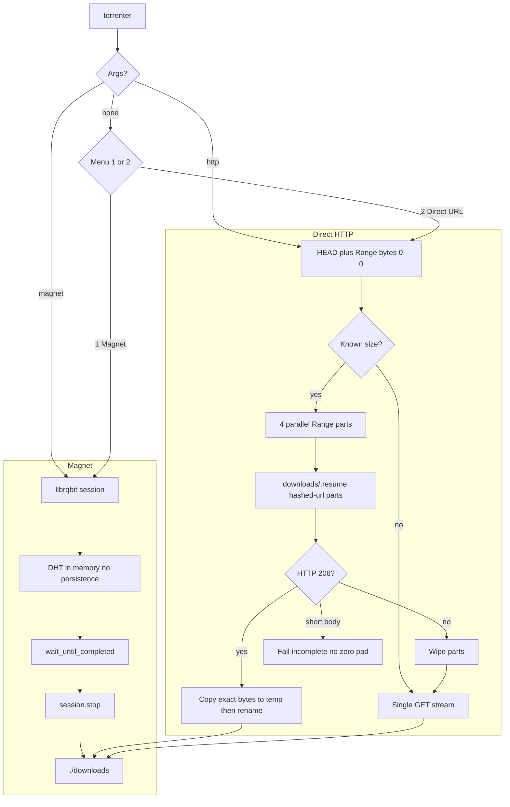

# torrenter

Downloader with two engines and two fronts. Each release ships a **CLI** binary and a **native GUI** binary (egui, no HTML/CSS).

1. **Magnet / torrent** — BitTorrent via [librqbit](https://github.com/ikatson/rqbit)
2. **Direct HTTP(S)** — 4-part parallel download with byte-range resume

Output goes to `./downloads/`. Runs on Linux, macOS, and Windows. Both fronts show `danted4/torrenter vX.Y.Z`.

## Two download modes

| | **Magnet / torrent** | **Direct HTTP(S)** |
|---|----------------------|---------------------|
| **Use when** | magnet / `.torrent` P2P | CDN, mirror, or any direct file URL |
| **Input** | `magnet:?xt=urn:btih:…` | `https://example.com/file.iso` |
| **Engine** | librqbit | `reqwest` + `Range: bytes=` |
| **Parallelism** | piece picker | 4 byte-range parts |
| **Resume** | librqbit on disk | `downloads/.resume/` part files |
| **Peers** | live count in the bar | `Peers: 0` |
| **Fallback** | — | single stream if the server ignores ranges |

Single-stream HTTP **does not resume**. It truncates the destination and starts over.

## Install

Pre-built binaries are on [GitHub Releases](https://github.com/danted4/torrenter/releases):

| OS | CLI | GUI |
|----|-----|-----|
| Linux x86_64 | `torrenter-x86_64-unknown-linux-gnu` | `torrenter-gui-x86_64-unknown-linux-gnu` |
| macOS Apple Silicon | `torrenter-aarch64-apple-darwin` | `torrenter-gui-aarch64-apple-darwin` |
| macOS Intel | `torrenter-x86_64-apple-darwin` | `torrenter-gui-x86_64-apple-darwin` |
| Windows x86_64 | `torrenter-x86_64-pc-windows-msvc.exe` | `torrenter-gui-x86_64-pc-windows-msvc.exe` |

On Unix: `chmod +x` the file and put it on your `PATH`. No Rust/Cargo needed at runtime.

A `vX.Y.Z` tag whose commit is on `main` builds those assets.

From source (Rust 1.85+):

```bash
git clone https://github.com/danted4/torrenter.git
cd torrenter
cargo build --release
cargo build --release --features gui --bin torrenter-gui
./target/release/torrenter              # Windows: .\target\release\torrenter.exe
./target/release/torrenter-gui          # Windows: .\target\release\torrenter-gui.exe
```

## Usage

Interactive (no arguments):

```
danted4/torrenter v3.0.2
auto-update: off
Choose download type:
1. Magnet URL
2. Direct URL (multi-part)
3. Toggle auto-update
4. Update now
```

Commands:

```bash
torrenter magnet "magnet:?xt=urn:btih:…"
torrenter http "https://example.com/large-file.iso"
torrenter --auto-update          # persist: check GitHub Releases on startup
torrenter --no-auto-update
torrenter update                 # install the latest matching CLI asset now
```

GUI: same engines, phosphor / amber / ice themes, checkbox for auto-update. The GUI binary only replaces itself with `torrenter-gui-*` assets; the CLI binary only replaces itself with `torrenter-*` assets. The binary directory must be writable.

Magnet links need a 32-character base32 or 40-character hex info hash. HTTP names come from `Content-Disposition` or the URL path (one path component only; `.` / `..` become `download.bin`).

Torrent mode uses DHT in memory only and calls `session.stop()` when the download finishes. Each magnet writes into `./downloads/<info-hash>/` so two torrents with the same filenames do not clobber each other; overwrite is allowed only inside that folder so a retry can resume.

HTTP **pause** aborts the live Range body and continues from `downloads/.resume/` on resume. Pause on a single-stream (no Range) download starts that GET over. Stop is honored during HEAD, range probe, part copy, and merge.

The GUI runs jobs concurrently. Each row has its own job id; errors attach to that row, not the first matching URL.

Self-update downloads only `danted4/torrenter` GitHub Release assets, requires `SHA256SUMS`, caps size, and times out. CLI auto-update on startup runs only on an interactive TTY.

## Progress bar

```
[████████████████░░░░] 75% | Peers: 12 | D: 750.45 MB @ 2.5 MB/s | T: 1.0 GB | ETA: 2 minutes
```

## How it works



HTTP resume keeps `{sha256(url)[0..16]}.part-N` plus a small JSON manifest under `downloads/.resume/`. Oversized parts are truncated before append; a short 206 is an error, not a zero-filled hole. Merge writes `.{filename}.merge.tmp` then replaces the final file.

## Configuration

- Download folder: `./downloads` (`DOWNLOAD_DIRECTORY` in `src/http.rs`)
- Parallel parts: `PART_COUNT = 4` in `src/http.rs`
- Progress format: `BAR_TEMPLATE` in `src/progress.rs`
- HTTP timeouts: 20s connect, 60s between reads
- Auto-update flag: `~/.config/torrenter/config.json` (macOS: `~/Library/Application Support/torrenter/config.json`, Windows: `%APPDATA%\torrenter\config.json`)

## Development

```bash
cargo test --all-features
cargo fmt --check
cargo clippy --all-targets --all-features -- -D warnings
```

CI on every push and pull request to `main`: fmt, clippy (`-D warnings`), tests on Linux, macOS, and Windows (`--all-features` so the GUI compiles).

Release: `git tag v3.0.2 && git push origin v3.0.2` (commit must already be on `main`).

## Troubleshooting

| Problem | Fix |
|---------|-----|
| `Invalid magnet URL` | Must start with `magnet:?xt=urn:` and a 32-char base32 or 40-char hex hash |
| No peers / slow torrent | Wait for DHT; try a seeded magnet; check firewall/UDP |
| `Too many open files` | torrenter raises the process limit when it can; otherwise `ulimit -n 10240` and retry |
| `Invalid HTTP(S) URL` | Full `http://` or `https://` URL required |
| Multipart not used | Server did not return HTTP 206 — single stream is used instead |
| Resume not working (HTTP) | Same URL; state is in `downloads/.resume/` |
| Incomplete part | Server closed a Range early; retry the same URL |
| Linux GUI missing GTK/xcb | `torrenter-gui-*-linux-gnu` is dynamically linked; install GTK 3 and xcb (`libgtk-3-0 libxkbcommon0 libxcb-render0 libxcb-shape0 libxcb-xfixes0` on Debian/Ubuntu) |
| Rust version error | Recent stable toolchain if building from source (`rustup update`) |

## Responsible use

Download only **content you have the legal right to access**. Generic tool — not affiliated with rqbit beyond using their OSS library.

## License

[MIT](LICENSE)
